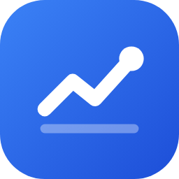
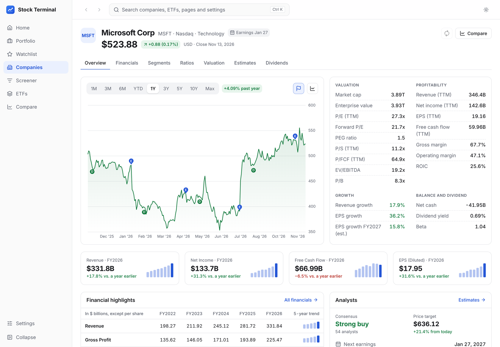
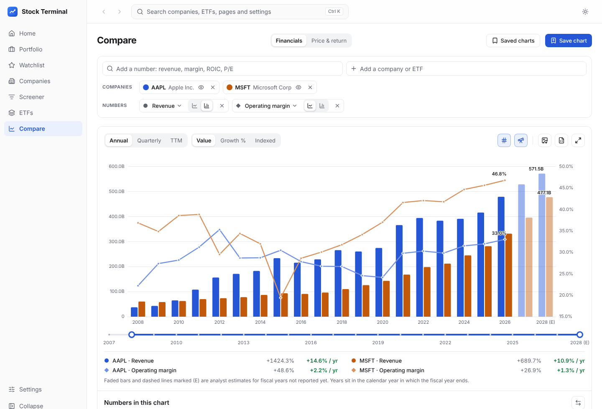
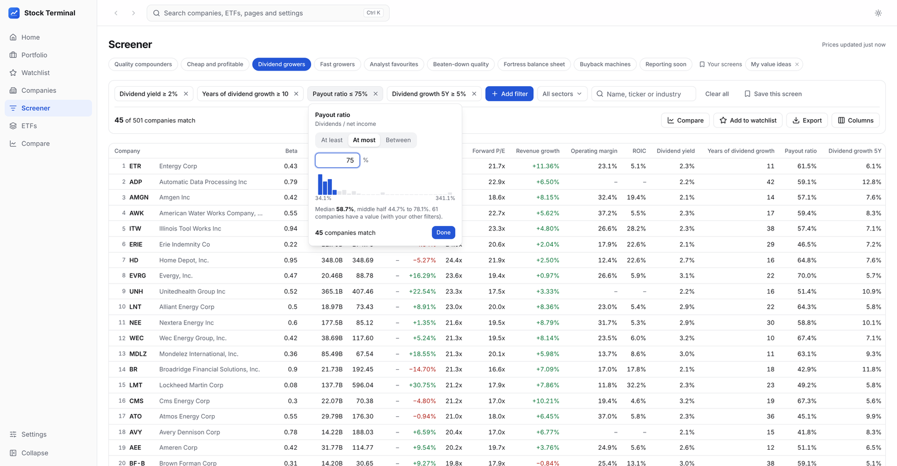

<p align="center"></p>

<h1 align="center">Stock Terminal</h1>

<p align="center">
A free stock research app for your own computer.<br>
The financials of every US listed company, a screener, side-by-side charts, watchlists and alerts,<br>
built on free public data. No account, no subscription, no API keys.
</p>

<p align="center">
<a href="https://github.com/nielstroep5-creator/stock-terminal/releases/latest"><b>Download for Windows or Mac</b></a> ·
<a href="https://nielstroep5-creator.github.io/stock-terminal/">Website</a> ·
<a href="CHANGELOG.md">What's new</a> ·
<a href="CONTRIBUTING.md">Contribute</a>
</p>

<p align="center"></p>

## What it does

- **Every US company.** Income statement, balance sheet, cash flow, segments, ratios and valuation, annual,
  quarterly and TTM, back to 2009, straight from the SEC filings. All numbers in US dollars, also for foreign filers.
- **Compare.** Chart any number (revenue growth, margins, ROIC, P/E, price) for several companies side by
  side, with analyst estimates for the years ahead. Save your charts and export them.
- **Screener.** Filter on about 75 numbers per company, start from ready-made screens and save your own.
- **Watchlists, alerts and a portfolio.** Price limits, big moves, results and dividend changes, in the app and on
  your phone. Optionally link a Trading 212 account for your holdings, tax and costs.
- **ETFs, dividends, earnings calendar, sectors, insiders and big investors.**
- **Your data stays yours.** Everything is stored on your own computer. The app updates itself.

<p align="center"></p>

<p align="center"></p>

## Install

1. Download the newest version from [Releases](https://github.com/nielstroep5-creator/stock-terminal/releases/latest):
   the installer (`.exe`) for Windows 10/11, or the `-mac.zip` for macOS.
2. Windows may warn about an unknown publisher (the app is not code-signed): click **More info**, then **Run anyway**.
3. Enter an email address on first start. The SEC asks every tool for a contact address; it never leaves your computer
   except in requests to the SEC.
4. Click **Get the S&P 500** for a ready-made starter pack, or search any company to load it.

Problems? In the app: Settings > About > **Report a problem**, or [open an issue](https://github.com/nielstroep5-creator/stock-terminal/issues/new/choose).

## Where the data comes from

- [SEC EDGAR](https://www.sec.gov/edgar): every XBRL financial fact companies file, turned into standard line
  items by rules that work for all companies (no per-company tweaks).
- Yahoo Finance (through [yfinance](https://github.com/ranaroussi/yfinance)): prices, dividends, splits, analyst
  estimates, news.

> **Not investment advice.** All numbers are processed automatically from free sources and can be late or wrong.
> Check important numbers in the company's own reports.

## Run from source

Windows: install [Python 3.12](https://www.python.org/downloads/) and [Git](https://git-scm.com/download/win), then

```
git clone https://github.com/nielstroep5-creator/stock-terminal.git
cd stock-terminal
py -3.12 -m venv .venv
.venv\Scripts\python -m pip install -r requirements.txt
```

and double-click **Start Stock Terminal.bat**.

macOS or Linux: install Python 3.12 and Git, then

```
git clone https://github.com/nielstroep5-creator/stock-terminal.git
cd stock-terminal
python3.12 -m venv .venv
.venv/bin/python -m pip install -r requirements.txt
```

and double-click **Start Stock Terminal.command** (macOS), or run `.venv/bin/python -m stockterminal.app --serve`
and open http://127.0.0.1:8765 in a browser (Linux). A copy made this way
follows the newest development code; the installer only gets finished releases.
How the code is organised: [DEVELOPING.md](DEVELOPING.md).

## Stable releases and development

- `master` is where development happens. Every change goes through the self-test on GitHub.
- Finished versions are tagged (`v1.0.0`, `v1.1.0`, ...) and published under Releases. The installed app only
  updates to those.
- Test versions (`v1.1.0-rc1`) are published as pre-releases for people who want to try them first.

## Credits and licence

Built by Niels ([@nielstroep5-creator](https://github.com/nielstroep5-creator)) and TvR, with Claude.
Free and open source under the [MIT licence](LICENSE).
